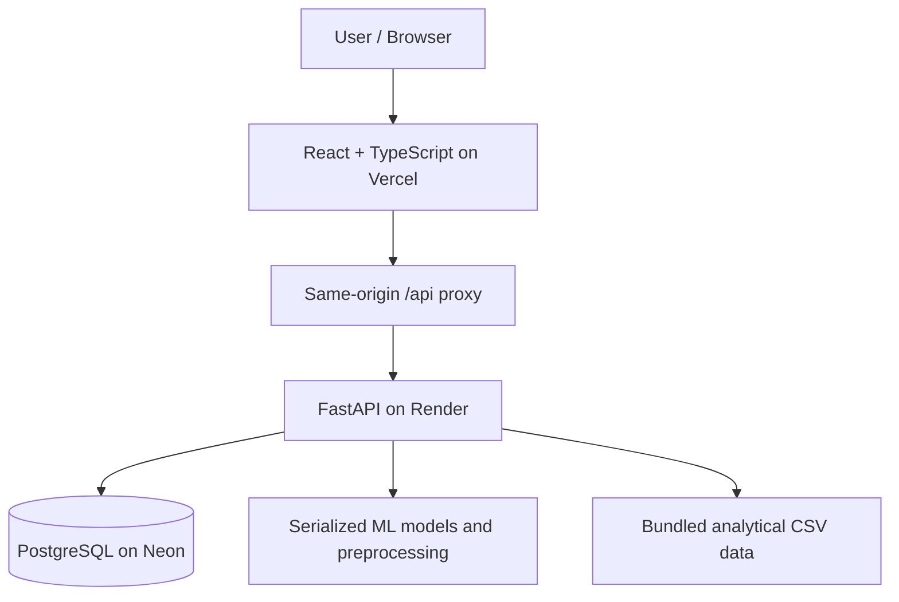

<div align="center">


# SCOPTIMA

### AI-Powered Supply Chain Decision Intelligence Platform

**Forecast Demand · Optimize Inventory · Reduce Holding Costs · Anticipate Stockouts**

[**🌐 Visit Live Website**](https://scoptima.vercel.app/) · [**💻 View Source on GitHub**](https://github.com/PIYUSHBARMAN7/SCOPTIMA) · [**📚 API Documentation**](https://scoptima-53we.onrender.com/docs)

   

**Designed & Developed by Piyush Barman & Sheikh Sameer Ali**

</div>

---

## Overview

**SCOPTIMA** is a full-stack supply-chain analytics platform designed to help teams make better inventory and operational decisions. It combines demand forecasting, inventory health analysis, stockout-risk prediction, holding-cost and excess-stock assessment, reporting, and role-based user access in one web application.

**Primary project focus:** **Supply Chain Inventory Holding Cost & Excess Stock Optimization** — identify potential excess inventory and estimate opportunities to reduce the cost of keeping unnecessary stock, while monitoring stockout risk.

> **Project note:** SCOPTIMA is a demonstration and decision-support platform. Predictions, modeled cost savings, and risk estimates are not guaranteed business outcomes. Uploaded datasets must match the selected model's required schema.

## Platform Features

| Module | What it does |
|---|---|
| Overview Dashboard | Summary KPIs, charts, trends and operational indicators |
| Demand Forecasting | Predict demand from compatible inputs and historical CSV datasets |
| Inventory Optimization | Review stock levels, safety stock, reorder points and excess inventory |
| Stockout Risk | Identify items likely to run out of stock using a classification model |
| Holding Cost & Savings | Assess potential holding-cost reductions and excess-stock opportunities |
| Comparison Mode | Compare warehouses, products, periods, and forecasts against actual values |
| Model Performance | Show relevant model evaluation metrics and comparisons |
| Reports | Present and export analytical summaries |
| Data Quality | Inspect completeness and validity of supported datasets |
| Run Analysis | Submit manual inputs or supported CSV datasets to prediction workflows |
| Authentication & Roles | Email/password, Google/GitHub OAuth and role-based feature access |

### User Workflow


## Machine Learning — In Simple Terms

| Model / approach | Use in SCOPTIMA | Explanation |
|---|---|---|
| **HistGradientBoosting Regressor** | Supply-chain and retail demand forecasting | Learns patterns from historical data to estimate numerical demand |
| **CatBoost Regressor** | Logistics KPI prediction | Predicts a numerical operational metric using logistics-related inputs |
| **CatBoost Classifier** | Stockout-risk classification | Estimates which stockout-risk class an inventory item belongs to |

Model experiments and benchmarks are distinct from the serialized artifacts used for live predictions. The repository includes trained `.pkl` artifacts and preprocessing configurations under `backend/models/`. These serialized files depend on compatible Python and machine-learning library versions.

## Data & Supported Uploads

SCOPTIMA uses structured supply-chain, inventory, logistics, and retail information. The repository snapshot includes these prepared data files:

| Dataset file | Rows in repository snapshot | Role |
|---|---:|---|
| `backend/data/logistics_inventory_optimization.csv` | 3,204 | Inventory optimization, excess stock and holding-cost analysis |
| `backend/data/logistics_stockout_predictions.csv` | 641 | Stockout-risk predictions and analysis |
| `backend/data/supply_chain_predictions.csv` | 12,750 | Supply-chain forecast output and comparison |
| `backend/data/retail_predictions.csv` | 10,600 | Retail forecast output and comparison |
| `backend/data/logistics_model_metrics.csv` | 5 | Model evaluation records |
| `backend/data/retail_model_metrics.csv` | 7 | Model evaluation records |

These counts describe the **included files** in the inspected project snapshot, not necessarily the size of original training datasets. The prediction CSVs contain prepared results rather than raw training datasets.

### What can users upload?

Supported analysis workflows accept **CSV** data with the columns and data types expected by the selected model. Depending on the workflow, this may include dates, product or SKU identifiers, warehouse attributes, sales quantities, stock levels, demand history, lead time, or reorder information. Some forecasting paths generate lag, rolling and calendar features from historical data.

**Not every arbitrary CSV will work.** For exact requirements, select a model in **Run Analysis** and inspect its required fields before uploading. Invalid or incomplete data should be corrected before predictions are used.

## Architecture



| Layer | Technology |
|---|---|
| Frontend | React, TypeScript, Vite, CSS, Lucide |
| Backend API | Python, FastAPI, SQLAlchemy |
| Database | PostgreSQL (Neon); SQLite for local development |
| ML & Data | scikit-learn, CatBoost, pandas, NumPy, joblib; additional experiment dependencies |
| Authentication | JWT HTTPOnly cookies, Google/GitHub OAuth, email OTP workflows |
| Hosting | Vercel frontend, Render backend |
| Source control | Git and GitHub |

## Access Roles

| Capability | Analyst | Executive / Viewer |
|---|---|---|
| View dashboards and analytics | Yes | Yes |
| View comparisons and reports | Yes | Yes |
| Execute ML analysis | Yes | Restricted |
| Upload datasets for model runs | Yes | Restricted |

Analyst registration uses a server-side authorization code. Production deployments should use secure invitations/role administration rather than distributing that code publicly.

## Run Locally

**Prerequisites:** Supported Python version, Node.js/npm, and valid private backend credentials.

### 1. Clone

```bash
git clone https://github.com/PIYUSHBARMAN7/SCOPTIMA.git
cd SCOPTIMA
```

### 2. Start the FastAPI backend

```bash
cd backend
python -m pip install -r requirements.txt
python -m uvicorn app.main:app --reload
```

Configure `backend/.env` before starting. Example **variable names only**:

```dotenv
APP_ENV=development
FRONTEND_URL=http://localhost:5173
DATABASE_URL=sqlite:///./scoptima.db
SECRET_KEY=GENERATE_YOUR_OWN_PRIVATE_KEY
OAUTH_STATE_SECRET=GENERATE_A_DIFFERENT_PRIVATE_KEY
```

Other OAuth, SMTP, and access-control variables depend on the features you enable. Never commit credentials. API docs: `http://localhost:8000/docs`.

### 3. Start the frontend

In another terminal:

```bash
cd frontend
npm install
npm run dev
```

Visit **http://localhost:5173**.

### Production routing

The Vercel frontend proxies `/api/*` traffic to the Render-hosted FastAPI service. Configure production CORS, cookie security, callback URIs and API routing consistently. Never point production browser requests to `localhost`.

## Current Limitations and Future Work

- Verify OAuth and authentication sessions across all supported browsers.
- Complete persistent storage for prediction history and OTP state.
- Improve input validation, human-readable errors, and end-to-end tests.
- Pin and validate trained-model library versions to prevent serialized-artifact loading failures.
- Add AI-assisted explanations, what-if inventory simulations and proactive stockout alerts.
- Strengthen monitoring, audit logs, secrets management, backups and scaling.

## Developers

**Piyush Barman** · **Sheikh Sameer Ali**

Project repository: [github.com/PIYUSHBARMAN7/SCOPTIMA](https://github.com/PIYUSHBARMAN7/SCOPTIMA)

Live website: [scoptima.vercel.app](https://scoptima.vercel.app/)

*SCOPTIMA — Supply Chain Inventory Holding Cost & Excess Stock Optimization*
